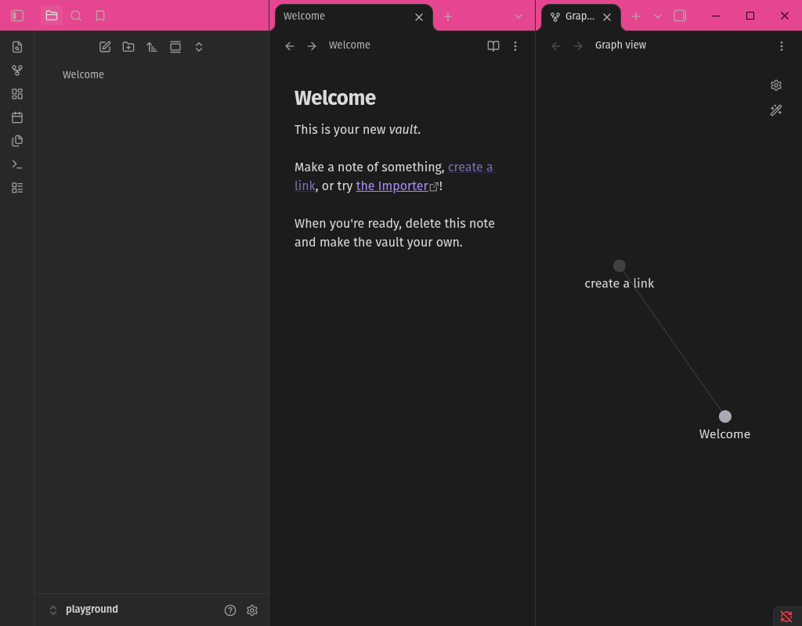
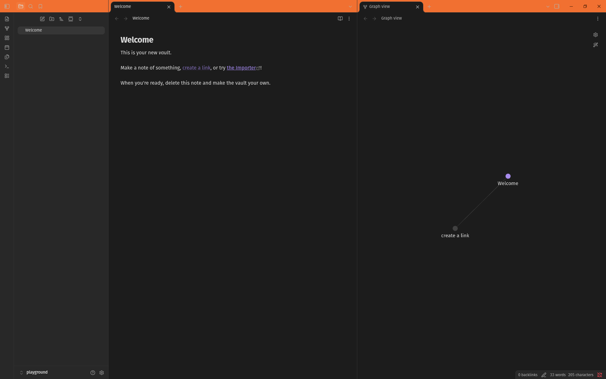
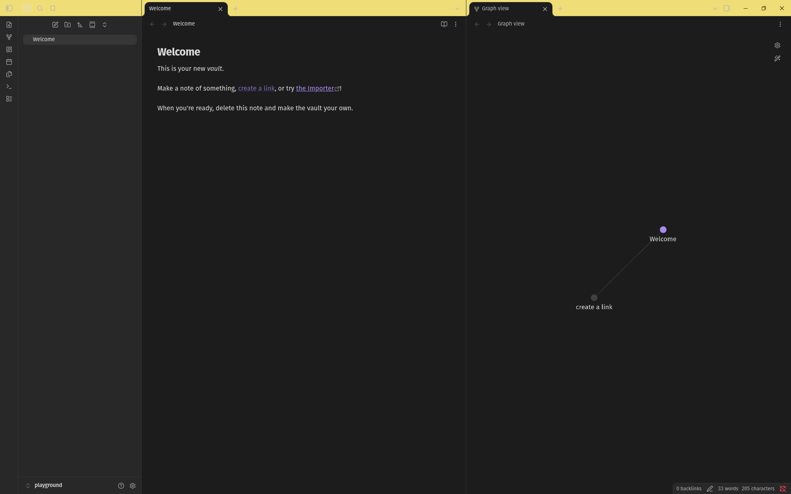
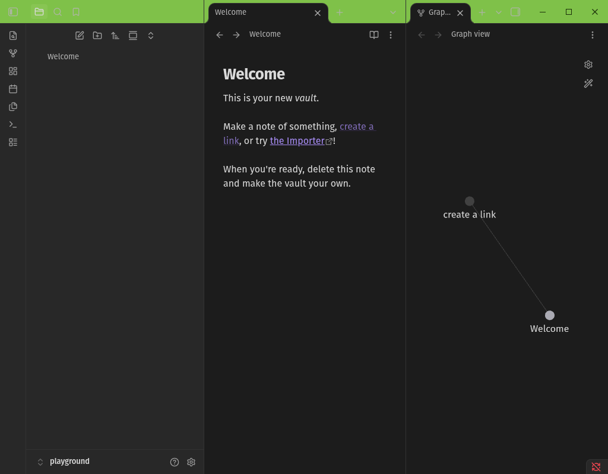
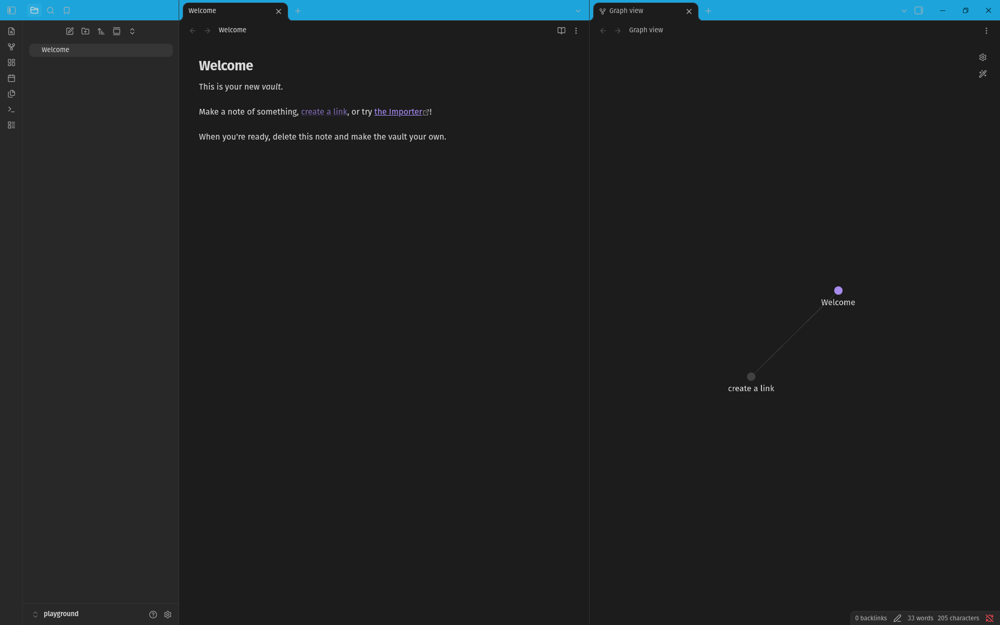
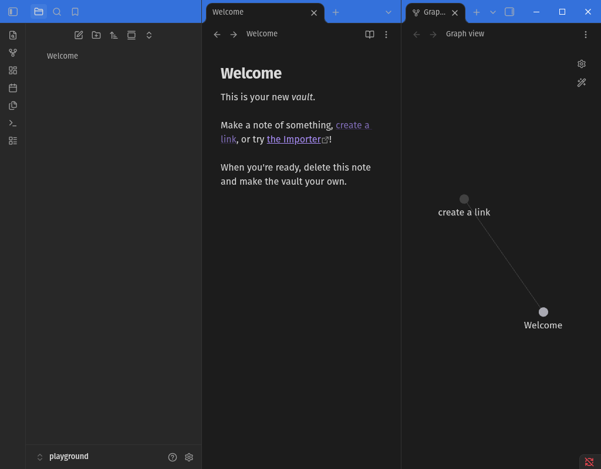
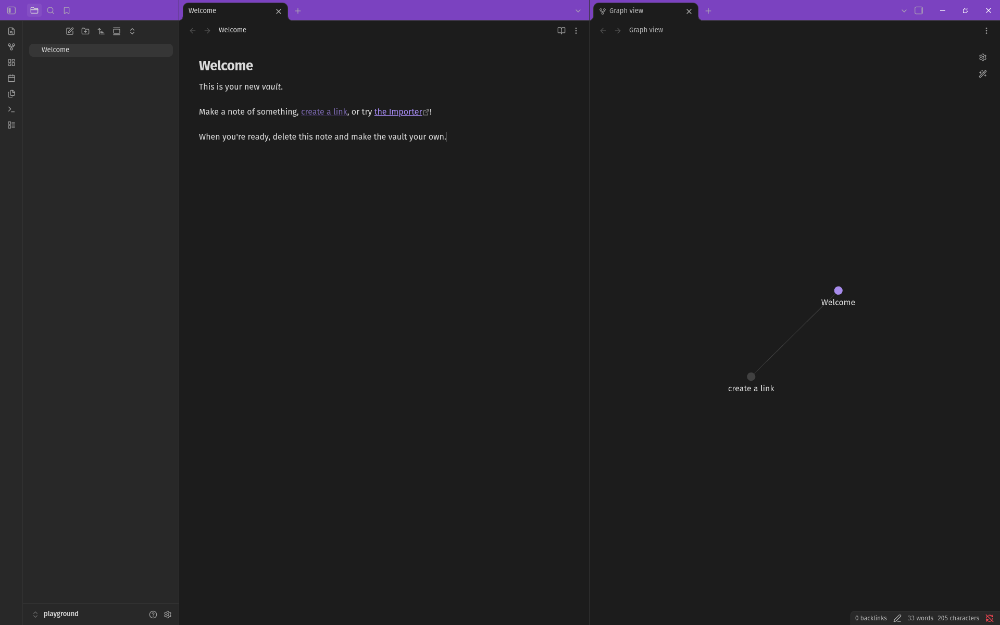
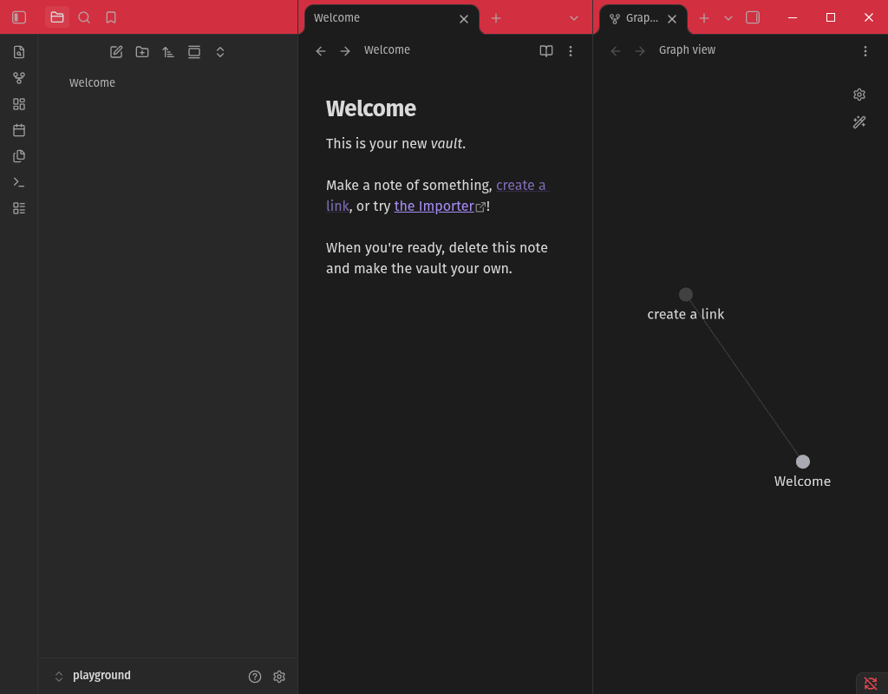

# Vanity Windows

An Obsidian Notes plugin for changing the window color on a per vault basis. Handy for when you have multiple vaults open and need an easy way to tell them apart.

Inspired by the [Peacock VS Code extension](https://marketplace.visualstudio.com/items?itemName=johnpapa.vscode-peacock).

## Setup

1. Add the plugin to Obsidian and ensure it's enabled.
2. In Settings, go to Community Plugins -> Vanity Windows.
3. Select your desired theme.

## Themes

Bubblegum

Tangerine

Lemonade

Lime Soda

Aqua

Electric Blue

Grape

Coral

## Development

1. Basic steps: `npm install; npm run dev`
2. Set up a symlink to your test vault: `ln -s "$PWD" <vault>/.obsidian/plugins/vanity-windows`

Open settings and it'll show up under Community plugins.
